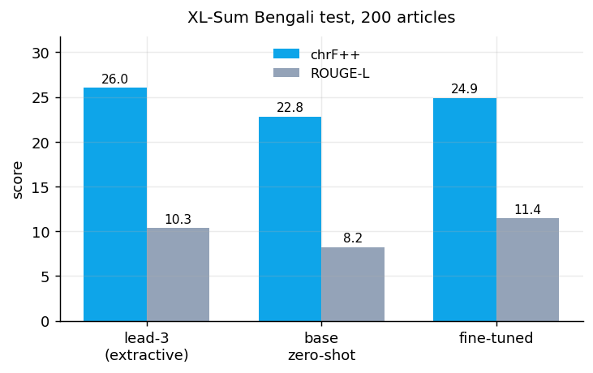
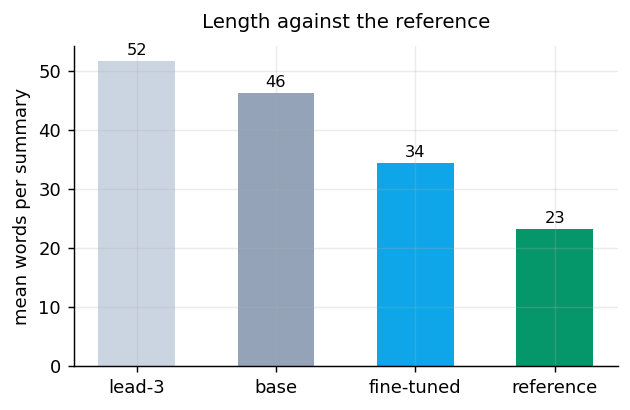
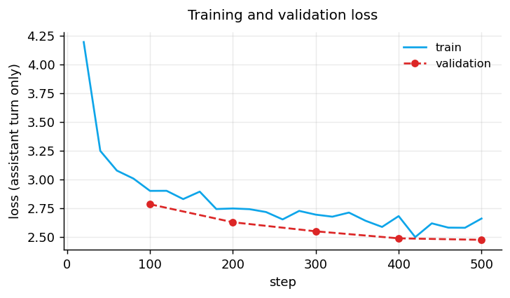

<p align="center">
  <a href="https://huggingface.co/emonHasan01/bangla-summarizer-pro">
    
  </a>
  <a href="https://huggingface.co/spaces/emonHasan01/bangla-summarizer-pro-demo">
    
  </a>
  <a href="https://huggingface.co/emonHasan01/bangla-summarizer-pro-GGUF">
    
  </a>
  <a href="https://huggingface.co/google/gemma-3-1b-it">
    
  </a>
  
  
  
  
</p>


<div align="center">

[Hugging Face](https://huggingface.co/emonHasan01) | [GitHub](https://github.com/Md-Emon-Hasan) | [LinkedIn](https://www.linkedin.com/in/md-emon-hasan-695483237/) | [WhatsApp](https://wa.me/8801834363533) | [Portfolio](https://emonlabs-ai.hitechparks.com/)

**Author:** [Md. Emon Hasan](https://huggingface.co/emonHasan01)

</div>

# bangla-summarizer-pro

**A complete fine-tune of [`google/gemma-3-1b-it`](https://huggingface.co/google/gemma-3-1b-it) for Bangla news
summarization — all 999,885,952 parameters**

Not LoRA, not an adapter. Every weight was updated on
[XL-Sum Bengali](https://huggingface.co/datasets/csebuetnlp/xlsum): 8,102 BBC Bangla
article–summary pairs written by professional editors.

**chrF++ improves from 22.78 to 24.91** against the base model (+2.13) — a real if modest gain on a 1B model and 8,102 training pairs.

Peak memory was **14.61 GB of 15**, in 184 minutes.

## Results

200 held-out XL-Sum Bengali test articles, greedy decoding with
`repetition_penalty=1.1`.



| | chrF++ | ROUGE-L | mean words |
|---|---|---|---|
| lead-3 (extractive) | 26.02 | 10.34 | 51.6 |
| `google/gemma-3-1b-it` zero-shot | 22.78 | 8.23 | 46.2 |
| **bangla-summarizer-pro** | **24.91** | **11.43** | **34.4** |
| *reference* | — | — | *23.3* |

**Both baselines are here on purpose.** Lead-3 copies the first three sentences of the
article; on news it is famously hard to beat, and a summarizer that cannot is not
summarizing. The zero-shot base model is the harder question: Gemma-3-1B can already write
Bangla, so the only thing worth measuring is whether this fine-tune improved on what it did
for free.

**chrF++ is the primary metric, not ROUGE.** It scores character n-grams, so a Bangla word
inflected differently from the reference still earns partial credit. Word-level ROUGE scores
it zero, which makes ROUGE systematically pessimistic and noisy on a morphologically rich
language. ROUGE-L is reported for comparability with other work, not because it is the better
measure here.



Length matters more than it looks. A model that writes 46 words against
a 23-word reference loses points for verbosity alone, independently of content.
Part of any gain from fine-tuning on summarization data is simply learning the expected
length — worth knowing before attributing all of it to better comprehension.



Validation loss is measured every 100 steps on 300 held-out XL-Sum rows. It falls from 2.786 to 2.477 and was still falling at the end, so the run stopped before overfitting rather than after it.

### Sample summaries

| Reference | `gemma-3-1b-it` zero-shot | **bangla-summarizer-pro** |
|---|---|---|
| বরফে ঢাকা এন্টার্কটিকায় হয়তো বিশ্বের সবচেয়ে বিরূপ প্রাকৃতিক পরিবেশ। কিন্তু ব্রিটিশ | বরফের ভেতর লুকানো ১২০ বছরের পুরোনো একটি ফ্রুটকেক কেপ এডেয়ার অঞ্চলে পাওয়া গেছে। এটি ব | নরওয়ের একটি অভিযাত্রী দলের সদস্যরা এন্টার্কটিকায় যে একটি পুরনো কুঁড়েঘর খুঁজে পেয়ে |
| ইতালিতে অভিবাসীদের এক কেন্দ্রে একটি দু'বছরের শিশুর খৎনা করানোর সময় অতিরিক্ত রক্তক্ষর | এখানে সংবাদ প্রতিবেদনের সংক্ষিপ্তসার দেওয়া হলো: ইতালির রোমে একটি শিশুর মা অবৈধভাবে তা | ইটালিতে এক শিশুর খৎনা করানোর পর তার ভাইও একই সাথে খৎনা করিয়েছেন। |
| চীনের উহানে করোনাভাইরাসের প্রাদুর্ভাব ব্যাপকভাবে ছড়িয়ে পড়েছিল জানুয়ারি মাসের গোড় | করোনাভাইরাস মহামারীর কারণে চীন থেকে উড়ে যাওয়া শনাক্তকরণের ক্ষেত্রে বাংলাদেশ যথেষ্ট প্ | করোনাভাইরাস মহামারির বিস্তার ঠেকাতে চীন থেকে আসা মানুষের মধ্যে নমুনা পরীক্ষা বন্ধ করা |
| বাংলাদেশের কোভিড-১৯ প্রতিরোধে সীমান্তবর্তী জেলা ও উচ্চ সংক্রমিত এলাকায় অঞ্চল ভিত্তিক | ফুলবাড়ী সীমান্তে একজন যাত্রীর পরীক্ষা চলার সময় স্থানীয় প্রশাসন কঠোর নজরদারি বাড়াতে এব | বাংলাদেশে করোনাভাইরাস পরিস্থিতি মোকাবেলায় সরকারের বিভিন্ন পদক্ষেপের পাশাপাশি জনস্বাস |

## Usage

```python
from transformers import AutoTokenizer, AutoModelForCausalLM
import torch

tok = AutoTokenizer.from_pretrained("emonHasan01/bangla-summarizer-pro")
model = AutoModelForCausalLM.from_pretrained("emonHasan01/bangla-summarizer-pro", dtype=torch.float32,
                                             device_map="auto")

article = "আপনার বাংলা সংবাদ প্রতিবেদন এখানে..."
messages = [
    {"role": "system", "content": "আপনি একজন দক্ষ সংবাদ সম্পাদক। বাংলা সংবাদ প্রতিবেদনের সংক্ষিপ্তসার লেখেন।"},
    {"role": "user", "content": "নিচের সংবাদ প্রতিবেদনটির এক বা দুই বাক্যে সংক্ষিপ্তসার লিখুন।\n\n" + article},
]
prompt = tok.apply_chat_template(messages, tokenize=False, add_generation_prompt=True)
inputs = tok(prompt, return_tensors="pt", add_special_tokens=False).to(model.device)
out = model.generate(**inputs, max_new_tokens=128, do_sample=False, repetition_penalty=1.1)
print(tok.decode(out[0][inputs["input_ids"].shape[1]:], skip_special_tokens=True))
```

**Use greedy decoding.** Sampling introduces details the article does not contain, which for
a summarizer is the worst failure mode. The exact system prompt and instruction are in
[`prompt_format.json`](prompt_format.json) and were present in every training example.

### llama.cpp

| File | Size |
|---|---|
| `bangla-summarizer-pro.Q4_K_M.gguf` | 0.81 GB |
| `bangla-summarizer-pro.Q8_0.gguf` | 1.07 GB |

```bash
llama-cli -hf emonHasan01/bangla-summarizer-pro-GGUF:Q4_K_M --temp 0 -n 128
```

## Training

| | |
|---|---|
| Base model | `google/gemma-3-1b-it` |
| Method | **full fine-tune**, 999,885,952 of 999,885,952 parameters (100%) |
| Data | XL-Sum Bengali, 8,102 article–summary pairs |
| Max sequence | 512 tokens |
| Learning rate | 1e-05, cosine, 30 warmup steps |
| Batch | 2 × 8 accumulation = 16 effective |
| Steps | 500 (≈ one epoch over 8,102 pairs) |
| Validation | 300 XL-Sum rows, loss every 100 steps |
| Optimizer | `adamw_8bit`, `max_grad_norm=1.0` |
| Precision | fp32 (fp16 unsupported for Gemma-3) |
| Peak VRAM | **14.61 GB of 15.0** |
| Final loss | 2.8145 |

### Decisions behind those numbers

**The article is truncated, never the summary.** Trimming a summary mid-sentence teaches the
model to stop mid-sentence, which is a much worse failure than seeing a shorter article. Each
example's article is cut to whatever room is left after its summary and the prompt.

**Full fine-tuning rather than LoRA.** An adapter learns a low-rank correction; at 1B the
full tune fits free hardware, so there was no reason to settle for less.

**Learning rate 1e-05, an order below LoRA's.** Every weight moves, so steps must be small
or the multilingual ability the base arrived with is destroyed early.

**Loss on the assistant turn only**, so the gradient is not spent regenerating the article.

## Limitations

- **Abstractive summarizers hallucinate.** This one can state facts, numbers and names the
  article does not contain. Nothing here measures faithfulness, and chrF cannot detect it —
  a fluent invented sentence can score well.
- **BBC Bangla news only.** XL-Sum is professionally written news. Social media, legal text,
  conversation and literary prose are out of distribution.
- **200 test articles**, not the full 1,012-article split, to fit free GPU hours.
  Expect a point or two of noise.
- **8,102 training pairs** is small for a summarization fine-tune; most published work uses
  tens or hundreds of thousands.
- **Greedy decoding only.** Sampling was not evaluated and increases hallucination.
- **No human evaluation**, which for summarization is what ultimately matters.
- **English ability after fine-tuning was not measured.**

Read the summary before publishing it. Check every number and name against the article.

## What a v2 would change

1. **A faithfulness measure**, not just overlap — entity and number agreement between summary
   and article, which chrF and ROUGE both ignore entirely.
2. **More data.** XL-Sum Bengali has 8,102 training pairs; CrossSum and scraped Bangla news
   could multiply that.
3. **Longer sequences.** A 512-token window truncates most full articles.
4. **Human evaluation on a sample**, scored for accuracy and readability by a Bangla speaker.
5. **A 4B variant** once the recipe is settled.

## Reproducing

Produced both baselines, the training, all three charts and
this card. Raw numbers in [`results.json`](results.json).

## Citation

```bibtex
@inproceedings{hasan-etal-2021-xl,
  title     = {{XL}-Sum: Large-Scale Multilingual Abstractive Summarization for 44 Languages},
  author    = {Hasan, Tahmid and Bhattacharjee, Abhik and Islam, Md. Saiful and others},
  booktitle = {Findings of ACL}, year = {2021}
}
```
